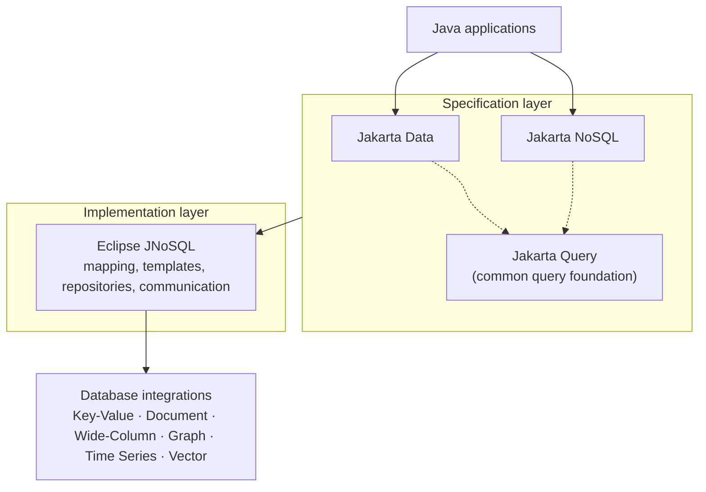

# Eclipse JNoSQL™ — Modern NoSQL Persistence for Enterprise Java


Eclipse JNoSQL™ is an open-source Java framework that simplifies NoSQL persistence through Jakarta EE standards. It provides implementations and integrations for [Jakarta Data](https://github.com/jakartaee/data) and [Jakarta NoSQL](https://github.com/jakartaee/nosql), and is aligned with [Jakarta Query](https://github.com/jakartaee/query), the common query foundation of the Jakarta persistence specifications. It brings repository abstractions, object mapping, and database-specific capabilities to enterprise Java applications.

One framework covers six NoSQL database models: **Key-Value**, **Document**, **Wide-Column**, **Graph**, **Time Series**, and **Vector**. Developers keep a familiar, annotation-based and CDI-integrated programming experience, reduce persistence boilerplate, and still reach the specific features of each database instead of being limited to the lowest common denominator.

> **Specification status:** Jakarta Data and Jakarta NoSQL are implemented by the current code base (including derived queries, `@Query`, and JDQL with named parameters). Jakarta Query is not yet a dependency of the Eclipse JNoSQL modules, so its integration is **under development** and is not presented here as a released capability.

## Built on Jakarta EE Standards

Eclipse JNoSQL is designed around three Jakarta EE specifications, each covering a different concern.

### Jakarta Data

[Jakarta Data](https://github.com/jakartaee/data) standardizes repository-oriented persistence.

* **Repository interfaces** — declare an interface and let JNoSQL provide the implementation.
* **Derived queries** — queries built from method names such as `findByName`.
* **Query capabilities** — annotation-based queries (`@Query`) and the Jakarta Data Query Language (JDQL), including named parameters.
* **Pagination** — pagination and sorting through the standard `Limit`, `Sort`, and `PageRequest` types.

This removes most of the persistence boilerplate:

```java
@Repository
public interface GodRepository extends BasicRepository<God, String> {

    Optional<God> findByName(String name);

    @Find
    List<God> byPower(@By("power") String power);
}
```

### Jakarta NoSQL

[Jakarta NoSQL](https://github.com/jakartaee/nosql) defines mapping and persistence for NoSQL databases.

* **Entity mapping** — `@Entity`, `@Id`, `@Column`, `@Embeddable`, and `@Convert`, among others.
* **Database-specific persistence models** — Key-Value, Document, and Wide-Column in the specification, extended by JNoSQL with Graph, Time Series, and Vector.
* **Templates** — `Template` and model-specific templates for operations beyond conventional CRUD, such as time to live.
* **CDI integration** — entities, templates, and repositories are discovered and injected through CDI.
* **Provider flexibility** — the same mapping works across databases of the same model.

Jakarta NoSQL provides abstractions suited to NoSQL databases rather than treating every NoSQL database as a relational one.

```java
@Entity
public class God {

    @Id
    private String id;

    @Column
    private String name;
}

@Inject
Template template;

template.insert(new God("diana", "Diana"), Duration.ofSeconds(10));
```

### Jakarta Query

[Jakarta Query](https://github.com/jakartaee/query) is the common query foundation for Jakarta persistence technologies.

* **Common query concepts** and a shared language, rather than one dialect per specification.
* **Reusable query expressions** across Jakarta Data and Jakarta NoSQL.
* **Type-oriented query capabilities** where supported.
* **Consistency** across Jakarta persistence specifications.

Jakarta Query is a specification-level foundation, not an extra runtime service. Jakarta Data and Jakarta NoSQL build on the same query concepts, and Eclipse JNoSQL is the layer that executes them against databases. Its support in JNoSQL is *under development*, and not every Jakarta Query feature is expected to be available in every database integration.

### Architecture



| Specification | Repository |
|---|---|
| Jakarta Data | [jakartaee/data](https://github.com/jakartaee/data) |
| Jakarta NoSQL | [jakartaee/nosql](https://github.com/jakartaee/nosql) |
| Jakarta Query | [jakartaee/query](https://github.com/jakartaee/query) |

## One Framework. Six Database Models.

Use the right NoSQL model for your application while keeping a familiar, standards-oriented Java programming experience.

| Model | Description | Typical use cases |
|---|---|---|
| **Key-Value** | Efficient key-based data access. | Caching, session management, fast lookups |
| **Document** | Flexible document-oriented persistence. | Product catalogs, content, user profiles |
| **Wide-Column** | Distributed column-family data storage. | Large datasets, high-throughput applications, distributed systems |
| **Graph** | Relationship-oriented data access and traversal. | Fraud detection, relationship analysis, recommendations |
| **Time Series** | Time-indexed data storage and retrieval. | Metrics, financial events, monitoring, IoT |
| **Vector** | High-dimensional vector persistence and similarity-oriented retrieval. | Semantic search, recommendations, embeddings, AI-assisted applications, RAG |

### Vector databases

Vector persistence is a general database capability: similarity search, recommendations, and retrieval over embeddings are only some of its uses. The `jnosql-mapping-vector` module adds:

* `VectorTemplate` — extends the Jakarta NoSQL `Template` with vector similarity search.
* `Vector` — the base type of a persisted vector attribute.
* `DenseVector` — a value for every dimension, typical for model embeddings.
* `SparseVector` — only non-zero values and their positions.
* `MultiVector` — one logical value represented by several dense vectors.

```java
@Inject
VectorTemplate template;

Vector queryVector = DenseVector.of(0.10F, 0.42F, 0.80F);

List<Article> articles = template.search(Article.class)
        .vector(queryVector)
        .limit(Limit.of(10))
        .result();
```

See the [supported databases](/docs/supported_dbs.html) for the integrations available for each model.

## Why Eclipse JNoSQL

* Increase productivity performing common NoSQL operations
* Rich object mapping integrated with Contexts and Dependency Injection (CDI)
* Repository abstractions, Java-based queries, and fluent APIs
* Persistence lifecycle events
* A specific template API for each NoSQL model
* Annotation-oriented, using JPA-like naming where it makes sense
* Extensible to explore the particular behavior of each NoSQL database
* Apache TinkerPop integration for graph databases

## Get started

* [Introduction](/docs/introduction.html)
* [Supported databases](/docs/supported_dbs.html)
* [Eclipse JNoSQL](https://github.com/eclipse-jnosql/jnosql) · [Database integrations](https://github.com/eclipse-jnosql/jnosql-databases) · [Extensions](https://github.com/eclipse-jnosql/jnosql-extensions)
