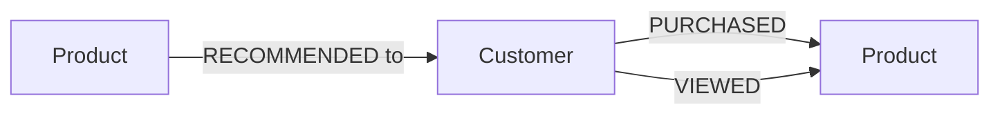
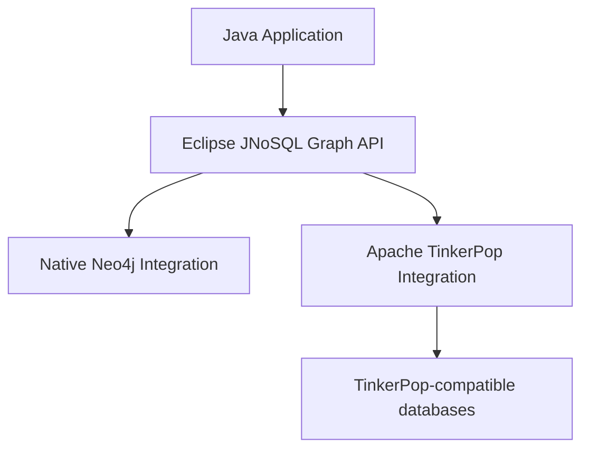

## 1. Introduction to Graph Databases

A graph database stores data as a graph and treats relationships as first-class data. The model used by the current JNoSQL integrations is the **property graph**:

* **Vertices (nodes)** represent entities.
* **Edges (relationships)** connect two vertices. They are directed, from a source to a target.
* **Labels** classify vertices and edges (for example `Customer` or `PURCHASED`).
* **Properties** are key-value pairs on vertices and on edges.
* **Traversal** navigates the graph by following edges from one vertex to the next.

### Why Graph Databases?

Graph databases are useful when relationships are central to the domain, because they make relationships explicit and provide specialized ways to navigate connected data. Typical use cases include:

* Fraud detection
* Social networks
* Recommendation systems
* Knowledge graphs
* Identity and access relationships
* Supply-chain analysis
* Connected financial data

### Trade-offs

Graph databases are not always superior to relational or document databases for connected data. Consider:

* Traversal cost, graph density, and traversal depth.
* Supernodes: highly connected vertices that make traversals expensive.
* Data distribution across machines.
* Indexing choices.
* Transaction semantics, which vary by database.
* Query-language differences between providers.
* Operational complexity.

## 2. Understanding Vertices, Edges, and Properties

This guide models customers and products. The vertices are `Customer` and `Product`; the relationships are `PURCHASED`, `VIEWED`, and `RECOMMENDED`.



An edge has a direction and can carry data of its own. In `Customer --PURCHASED--> Product`, the edge can hold properties such as the timestamp, the quantity, and the purchase channel. This is why a relationship is not merely a Java object reference: it has its own identity, label, direction, and properties, and it is stored and traversed by the database instead of being rebuilt by application code.

## 3. Minimum Requirements

Before you start, make sure your application meets the common [Minimum Requirements](/docs/minimum.html) of Eclipse JNoSQL™. Apache TinkerPop is not a requirement of the Graph API. Additional dependencies are determined by the graph provider you select. The native Neo4j integration depends on the Neo4j Java driver and does not use TinkerPop.

## 4. One Graph API, Multiple Integrations

Eclipse JNoSQL provides a Graph Mapping API that is independent of the underlying database driver. Jakarta NoSQL does not currently define an API for Graph databases, so the graph-specific parts of this API (such as `GraphTemplate` and `Edge`) are Eclipse JNoSQL extensions, built on the common Jakarta NoSQL mapping.

**Java application** uses:

* Jakarta Data repositories.
* Jakarta NoSQL entity mapping.
* `GraphTemplate`.
* The `Edge` relationship abstraction.

**Eclipse JNoSQL Graph Mapping API** provides:

* Mapping of Java objects to vertices.
* Persistence operations and CDI integration.
* Relationship creation with edge properties.
* Graph-specific abstractions.

**Graph database integrations** (in [jnosql-databases](https://github.com/eclipse-jnosql/jnosql-databases)):

* Native Neo4j integration (`jnosql-neo4j`).
* Apache TinkerPop integration (`jnosql-tinkerpop`).



The application consumes the JNoSQL API. Apache TinkerPop is one integration path, not the definition of the Graph API.

## 5. Apache TinkerPop Integration

[Apache TinkerPop](https://tinkerpop.apache.org/) is a graph computing framework with the Gremlin traversal language, and it has long been significant in the Java graph ecosystem. Many graph systems provide TinkerPop support; the project lists them on its [providers page](https://tinkerpop.apache.org/providers.html).

It helps to distinguish three groups:

* Databases supported by the TinkerPop ecosystem.
* Providers directly integrated and tested by Eclipse JNoSQL; see the [jnosql-databases](https://github.com/eclipse-jnosql/jnosql-databases) repository.
* Databases that need additional configuration or external drivers.

Eclipse JNoSQL does not claim that every TinkerPop-supported database is tested or certified. You can keep using TinkerPop where it fits, while your application code stays focused on JNoSQL abstractions such as `GraphTemplate`. The integration also provides `TinkerpopTemplate`, a specialization of `GraphTemplate` that adds TinkerPop traversal operations; this guide does not center on Gremlin.

## 6. Native Neo4j Integration

Eclipse JNoSQL supports [Neo4j](https://neo4j.com/) directly. You use `GraphTemplate` without adopting TinkerPop as your programming model. The advantages are:

* Direct integration with the Neo4j Java driver.
* Reuse of JNoSQL entity mapping.
* Relationship persistence through the Graph API.
* Access to native capabilities that the integration exposes: `Neo4JTemplate` adds `cypher(...)` and `traverse(...)` (see Section 12).

This integration does not expose Gremlin, and it does not translate arbitrary Gremlin traversals. Cypher is available only through the explicit native operations in `Neo4JTemplate` and `Neo4JRepository`, not as a portable query language.

## 7. Adding the Graph Dependencies

Choose **one** integration; Neo4j and TinkerPop are alternative provider configurations, and you do not need both. Each integration brings the Graph mapping API (`jnosql-mapping-graph`) transitively, so you do not add it separately.

### Direct Neo4j Integration

```xml
<dependency>
    <groupId>org.eclipse.jnosql.databases</groupId>
    <artifactId>jnosql-neo4j</artifactId>
    <version>{{ site.jnosql_databases_version }}</version>
</dependency>
```

No TinkerPop or Gremlin dependency is required.

### Apache TinkerPop Integration

```xml
<dependency>
    <groupId>org.eclipse.jnosql.databases</groupId>
    <artifactId>jnosql-tinkerpop</artifactId>
    <version>{{ site.jnosql_databases_version }}</version>
</dependency>
```

This integration does not bundle Apache TinkerPop (`gremlin-core` is a provided dependency). Add the TinkerPop dependency required by your graph provider, if the provider does not already bring it, with the version your provider supports:

```xml
<dependency>
    <groupId>org.apache.tinkerpop</groupId>
    <artifactId>gremlin-core</artifactId>
    <version>${tinkerpop.version}</version>
</dependency>
```

The provider itself (for example, a TinkerPop-enabled database) needs its own dependency; see its documentation.

## 8. Configuring a Graph Database

Eclipse JNoSQL uses [MicroProfile Config](https://microprofile.io/specifications/microprofile-config/). The common properties are:

```properties
jnosql.graph.database=<DATABASE>
jnosql.graph.provider=<PROVIDER>
```

`jnosql.graph.database` selects the database name and `jnosql.graph.provider` selects the provider configuration class; the latter is needed when more than one integration is available.

### Native Neo4j

```properties
jnosql.neo4j.uri=bolt://localhost:7687
jnosql.neo4j.username=neo4j
jnosql.neo4j.password=${NEO4J_PASSWORD}
jnosql.neo4j.database=neo4j
```

These properties come from the Neo4j integration. Provide the password through an environment variable or your secrets management; do not commit real credentials. The Neo4j integration also reads `jnosql.graph.database`, defaulting to `neo4j`.

### Apache TinkerPop

TinkerPop configuration follows the requirements of the chosen provider. The integration selects the provider class with `jnosql.graph.tinkerpop.provider`, and it can also be configured programmatically by producing a TinkerPop `Graph`. See the [TinkerPop integration documentation](https://github.com/eclipse-jnosql/jnosql-databases#tinkerpop-integration) for the details.

## 9. Mapping Graph Entities

Graph entities use the common Jakarta NoSQL annotations; there is no graph-specific mapping annotation. A class marked with `@Entity` is stored as a vertex, `@Id` is its identifier, and `@Column` marks a persistent property. Entities need a non-private constructor without parameters.

```java
import jakarta.nosql.Column;
import jakarta.nosql.Entity;
import jakarta.nosql.Id;

@Entity
public class Customer {

    @Id
    private String id;

    @Column
    private String name;

    Customer() {
    }

    public Customer(String id, String name) {
        this.id = id;
        this.name = name;
    }

    public String getId() { return id; }

    public String getName() { return name; }
}
```

```java
@Entity
public class Product {

    @Id
    private String id;

    @Column
    private String name;

    Product() {
    }

    public Product(String id, String name) {
        this.id = id;
        this.name = name;
    }

    public String getId() { return id; }

    public String getName() { return name; }
}
```

The entity name is used as the vertex label, and the `@Column` fields become vertex properties. JNoSQL converts between these objects and the graph representation, so you do not build driver-level nodes or vertices by hand. Vertices represent entities; their edges represent relationships, not fields of the entity. How identifiers are generated and which Java types are supported can vary between integrations.

## 10. GraphTemplate — Working with Graph Data

`GraphTemplate` (`org.eclipse.jnosql.mapping.graph.GraphTemplate`) is the central abstraction for Graph persistence. It extends the common persistence API, so the familiar `Template` operations (insert, update, find, delete, and the fluent API) apply to vertices, and it adds edge operations.

```java
import jakarta.inject.Inject;
import org.eclipse.jnosql.mapping.graph.GraphTemplate;

@Inject
GraphTemplate template;

public void crud() {
    Customer customer = template.insert(new Customer("c-1", "Ada"));
    Product product = template.insert(new Product("p-1", "Mechanical Keyboard"));

    Optional<Customer> found = template.find(Customer.class, "c-1");

    template.update(new Customer("c-1", "Ada Lovelace"));

    template.delete(Product.class, "p-1");
}
```

Persistence semantics, identifier generation, and what happens to the edges of a deleted vertex depend on the integration and the database. Check your provider's documentation rather than assuming identical behavior. The examples use only JNoSQL types, not TinkerPop types.

## 11. Creating Relationships with the Edge API

Relationships are first-class: `Edge<S, T>` links a source vertex to a target vertex with a label and optional properties. The edge is directed from source to target.

```java
import org.eclipse.jnosql.mapping.graph.Edge;

Edge<Customer, Product> edge = Edge.source(customer)
        .label("PURCHASED")
        .target(product)
        .property("quantity", 2)
        .property("channel", "online")
        .build();

template.edge(edge);
```

* `source(customer)` is the vertex where the relationship starts.
* `label("PURCHASED")` names the relationship.
* `target(product)` is the vertex where it ends.
* `property(key, value)` adds data to the edge and can be repeated.
* `build()` creates the immutable `Edge`, and `template.edge(edge)` persists it.

The same entities can have a second relationship by changing the label and properties:

```java
template.edge(Edge.source(customer)
        .label("VIEWED")
        .target(product)
        .property("channel", "mobile")
        .build());
```

This is more expressive than storing identifiers as unrelated fields: the database understands the relationship, its direction, and its properties. `GraphTemplate` also offers `edge(source, label, target, properties)`, `findEdgeById`, `delete(Edge)`, and `deleteEdge(id)`.

## 12. Querying Graph Data

Graph queries differ from ordinary field-based queries: they often describe how vertices are connected, rather than only selecting records by scalar attributes. Typical tasks are traversing relationships, finding connected vertices, following outgoing or incoming edges, and filtering by vertex or edge properties.

Because `GraphTemplate` is part of the `Template` family, you can filter vertices by their properties with the fluent API (see Section 13):

```java
List<Customer> customers = template.select(Customer.class)
        .where("name").eq("Ada")
        .result();
```

`GraphTemplate` itself does not define a portable traversal API (for example, "customers who purchased this product"). Traversals beyond property filters, and queries on edge properties, require provider-specific functionality:

* **Neo4j and Cypher.** `Neo4JTemplate` extends `GraphTemplate` and offers `cypher(String, Map<String, Object>)` and `traverse(startNodeId, relationship, depth)`:

  ```java
  @Inject
  Neo4JTemplate template;

  Stream<Customer> customers = template.cypher(
          "MATCH (c:Customer) WHERE c.name = $name RETURN c",
          Map.of("name", "Ada"));
  ```

  `Neo4JRepository` additionally supports Cypher queries with the `@Cypher` annotation.
* **TinkerPop and Gremlin.** For TinkerPop-based providers, `TinkerpopTemplate` exposes Gremlin-based traversal operations.

Gremlin and Cypher are different query languages with different semantics. JNoSQL does not translate every Gremlin traversal into Cypher or the other way around, and native queries are not portable across providers.

## 13. Fluent Graph Operations

JNoSQL's own fluent programming experience in the Graph API has two parts.

**The Edge builder** expresses the source, the label, the target, and the properties in reading order, which is easier to maintain than assembling driver-level objects and parameter maps (Section 11).

**The fluent query API** from Jakarta NoSQL is available for vertices because `GraphTemplate` is a `Template`:

```java
template.delete(Customer.class)
        .where("name").eq("Ada")
        .execute();
```

These fluent operations are JNoSQL APIs and are not the Gremlin traversal DSL. As elsewhere, support for particular operators depends on the integration.

## 14. Using Jakarta Data Repositories with Graph Databases

Eclipse JNoSQL can expose Jakarta Data repositories for supported graph persistence operations. `BasicRepository` is supported by the Graph mapping module:

```java
import jakarta.data.repository.BasicRepository;
import jakarta.data.repository.Repository;

@Repository
public interface CustomerRepository
        extends BasicRepository<Customer, String> {
}
```

```java
@Inject
CustomerRepository repository;

public void usage() {
    repository.save(new Customer("c-1", "Ada"));

    Optional<Customer> customer = repository.findById("c-1");

    repository.deleteById("c-1");
}
```

Repository operations and graph traversals solve different problems:

* **Repository:** entity-oriented persistence.
* **`GraphTemplate`:** explicit work with graph entities and relationships.

Jakarta Data repositories do not automatically express arbitrary graph traversals.

## 15. Graph-Specific Capabilities and Trade-offs

Graph databases differ in capabilities that the common Graph API does not cover. Review:

* Traversal languages (Gremlin, Cypher).
* Relationship direction and edge properties.
* Identifier generation.
* Label handling.
* Transaction behavior.
* Indexing and traversal performance.
* Serialization.
* Native driver capabilities.

The framework reduces unnecessary application coupling while preserving access to specialized functionality, such as `Neo4JTemplate` and `TinkerpopTemplate`.

### Portability

Moving from a TinkerPop provider to native Neo4j, or between graph databases, can require:

* New provider dependencies.
* Configuration changes.
* Data migration.
* Query changes.
* Adaptation of native operations.
* Validation of transaction semantics.

Transparent database replacement is not promised.

## 16. Jakarta EE Data Ecosystem

* **Jakarta NoSQL:** the common mapping annotations and the `Template` and fluent APIs used here. The Graph-specific API (`GraphTemplate`, `Edge`) is an Eclipse JNoSQL extension, not part of the Jakarta NoSQL specification.
* **Jakarta Data:** repositories, as in Section 14.
* **[Jakarta Query](https://github.com/jakartaee/query):** a common query foundation for Jakarta persistence technologies. Its integration into Eclipse JNoSQL is under development and should not be assumed to be available.

See the [Introduction](/docs/introduction.html) for the overall architecture.

## 17. Explore Graph Database Integrations

You can use the JNoSQL Graph API with different supported providers:

* **Native integrations**, such as Neo4j.
* **Apache TinkerPop integrations**, which provide access to a broader ecosystem of graph databases.

Use the actual provider modules and their documentation as the authoritative compatibility list:

* [jnosql-databases](https://github.com/eclipse-jnosql/jnosql-databases)
* [jnosql-extensions](https://github.com/eclipse-jnosql/jnosql-extensions)
* [Apache TinkerPop](https://tinkerpop.apache.org/)
* [Supported Databases](/docs/supported_dbs.html)
* [Jakarta NoSQL](https://github.com/jakartaee/nosql) and [Jakarta Data](https://github.com/jakartaee/data)
* JNoSQL examples: [demos-se](https://github.com/JNOSQL/demos-se) and [demos-ee](https://github.com/JNOSQL/demos-ee)
