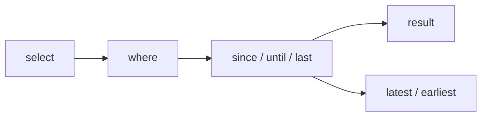

> **Upcoming release.** The temporal Fluent API (`since`, `until`, `last`, `latest`, `earliest`) is documented in the development (`main`) branch of [Eclipse JNoSQL](https://github.com/eclipse-jnosql/jnosql) and is **not** part of the released `1.1.20` artifacts: in `1.1.20`, `TimeSeriesTemplate` has no temporal query methods. Examples that depend on it are marked **(upcoming release)**. The common operations (`insert`, `find`, regular `select`) work with the released module.

## 1. Introduction to Time Series NoSQL Databases

A Time Series database stores and queries information organized around time. Every observation carries a timestamp, so time is a fundamental part of the data model, not just another attribute.

### Why Choose a Time Series Database?

* Efficient access to time-indexed information.
* Retrieval within temporal ranges.
* Analysis of recent or historical observations.
* Handling high-volume, append-oriented workloads.
* Retention policies, where the database supports them.
* Aggregations and time-based analytics.
* Potential storage optimizations for time-ordered data.

It is particularly useful when applications repeatedly ask:

* What happened during the last hour?
* What are the latest measurements?
* How has a metric changed over time?
* Which events occurred between two timestamps?
* What was the earliest recorded observation?

### Representative Use Cases

* Application monitoring.
* IoT sensors.
* Financial market data.
* Banking transaction events.
* Infrastructure telemetry.
* Industrial equipment measurements.
* Observability and audit-oriented workloads.

### Trade-offs

* High-cardinality identifiers and tags.
* Write ingestion rates.
* Retention and storage costs.
* Late-arriving events.
* Timestamp precision.
* Duplicate timestamps.
* Timezone handling.
* Aggregation capabilities.
* Historical data correction.
* Provider-specific consistency and query semantics.

Not every Time Series database supports identical retention, aggregation, or compression capabilities.

## 2. Modeling Data Around Time

A time series record generally combines a timestamp, an observed value, attributes that identify the measured entity, and optional metadata or tags. This guide uses `SensorReading`:

```java
import jakarta.nosql.Column;
import jakarta.nosql.Entity;
import jakarta.nosql.Id;

import java.time.Instant;

@Entity
public class SensorReading {

    @Id
    private Instant timestamp;

    @Column
    private String sensor;

    @Column
    private double value;

    SensorReading() {
    }

    public SensorReading(Instant timestamp, String sensor, double value) {
        this.timestamp = timestamp;
        this.sensor = sensor;
        this.value = value;
    }

    public Instant getTimestamp() { return timestamp; }

    public String getSensor() { return sensor; }

    public double getValue() { return value; }
}
```

* `@Entity` identifies the mapped entity.
* `@Id` identifies the temporal key used by the Time Series API.
* `@Column` maps persisted attributes.

### Important: Timestamp as the Identifier

The five temporal query operations use the field annotated with `@Id`. The implementation supports these identifier types: `Instant`, `LocalDateTime`, `LocalDate`, `OffsetDateTime`, and `ZonedDateTime`. Using another type makes a temporal operation fail with an `IllegalStateException`.

Time-oriented identity is not necessarily a database's physical partition key, series key, or primary key. Real applications can produce several measurements at the same timestamp, for example from different sensors. Timestamp uniqueness across sensors is **not** guaranteed automatically, so consider collisions, identity constraints, and your provider's series modeling. The tutorial dataset uses unique timestamps for simplicity.

## 3. Minimum Requirements

The Time Series mapping module follows the common platform requirements described in [Minimum Requirements](/docs/minimum.html). Additional dependencies and supported capabilities depend on the database provider.

## 4. Choosing a Time Series Database

Eclipse JNoSQL connects applications to Time Series databases through provider integrations. Consider:

* Query performance over time ranges.
* Ingestion rate.
* Data retention.
* Aggregations.
* Timestamp precision.
* Cardinality.
* Compression and storage costs.
* Distribution and availability.
* Authentication and operations.

The [jnosql-databases](https://github.com/eclipse-jnosql/jnosql-databases) repository is the authoritative list. At the time of writing, it contains Time Series drivers for **InfluxDB** (`jnosql-influxdb`), **Apache IoTDB** (`jnosql-iotdb`), and **QuestDB** (`jnosql-questdb`). Not every Time Series database can use the JNoSQL mapping API; only databases with an integration can. JNoSQL provides familiar Java persistence abstractions while each provider keeps its specialized capabilities.

## 5. Adding the Time Series Dependency

The mapping module is `jnosql-mapping-timeseries`:

```xml
<dependency>
    <groupId>org.eclipse.jnosql.mapping</groupId>
    <artifactId>jnosql-mapping-timeseries</artifactId>
    <version>${jnosql.version}</version>
</dependency>
```

Use a release that contains the temporal Fluent API for the **(upcoming release)** examples; the development branch is currently `2.0.0-SNAPSHOT`. The released `1.1.20` supports only the common operations. This website defines no JNoSQL core version variable, only `jnosql_databases_version` (`{{ site.jnosql_databases_version }}`), so set `jnosql.version` in your own build.

Distinguish two layers:

* **The mapping module** provides `TimeSeriesTemplate`, entity mapping, and repository support.
* **A database integration** connects to a concrete database. Each driver already includes the Time Series mapping module. For example, with InfluxDB:

```xml
<dependency>
    <groupId>org.eclipse.jnosql.databases</groupId>
    <artifactId>jnosql-influxdb</artifactId>
    <version>{{ site.jnosql_databases_version }}</version>
</dependency>
```

Drivers released alongside `{{ site.jnosql_databases_version }}` use the mapping module from that release, so the temporal operations are available only with a driver release built on the upcoming mapping version.

## 6. Configuring a Time Series Database

JNoSQL reads settings through [MicroProfile Config](https://microprofile.io/specifications/microprofile-config/). The generic properties are:

```properties
jnosql.timeseries.database=<DATABASE>
jnosql.timeseries.provider=<CLASS-DRIVER>
```

* `jnosql.timeseries.database` is the database name.
* `jnosql.timeseries.provider` is the fully qualified class of the provider configuration. It is required when more than one Time Series provider is on the classpath.

Provider-specific settings, such as host, port, credentials, or connection options, are defined by each driver. A verified example for InfluxDB 3:

```properties
jnosql.timeseries.provider=org.eclipse.jnosql.databases.influxdb.communication.InfluxDBTimeSeriesConfiguration
jnosql.timeseries.database=metrics
jnosql.influxdb.url=http://localhost:8181
jnosql.influxdb.token=${INFLUXDB_TOKEN}
```

Provide the token through an environment variable or secrets management. For other providers, see the [jnosql-databases](https://github.com/eclipse-jnosql/jnosql-databases) documentation.

## 7. TimeSeriesTemplate — Time-Oriented Persistence

`TimeSeriesTemplate` (`org.eclipse.jnosql.mapping.timeseries.TimeSeriesTemplate`) specializes the common Jakarta NoSQL `Template` abstraction. It keeps the common persistence concepts and overrides `select(Class)` to return a time-aware query that adds the temporal operations.

### Common Persistence Operations

```java
import jakarta.inject.Inject;
import org.eclipse.jnosql.mapping.timeseries.TimeSeriesTemplate;

@Inject
TimeSeriesTemplate template;

SensorReading reading = new SensorReading(
        Instant.now(),
        "sensor-1",
        21.5);

template.insert(reading);

Optional<SensorReading> result =
        template.find(SensorReading.class, reading.getTimestamp());
```

Entities are mapped through the Jakarta NoSQL annotations and the template is obtained through CDI. `update` and `delete(Class, id)` are inherited from `Template` as well, but how a provider treats them is database-specific: many time-series stores are append-oriented, so check your driver before relying on corrections or deletions.

### Why a Specialized Template?

CRUD alone does not express common temporal questions naturally: records within a range, the most recent measurements, or a relative time window. `TimeSeriesTemplate` provides these query semantics without forcing applications to build database-specific native queries.

## 8. Temporal Fluent API: Expressive Time-Based Queries

Time Series databases have their own query languages, range operators, and time-window functions. Without a common Java abstraction, applications become coupled to database-specific query construction. JNoSQL extends the familiar fluent query API with five temporal operations, all applied to the `@Id` attribute. **(upcoming release)**

| Operation | Kind | Semantics |
|-----------|------|-----------|
| `since(start)` | Intermediate | Identifier `>= start` (inclusive) |
| `until(end)` | Intermediate | Identifier `<= end` (inclusive) |
| `last(Duration)` | Intermediate | Identifier within `[now - duration, now]` |
| `latest(n)` | Terminal | Newest `n` observations, newest first |
| `earliest(n)` | Terminal | Oldest `n` observations, oldest first |

The variables used below:

```java
Instant end = Instant.now();
Instant start = end.minus(Duration.ofHours(1));
```

### 8.1 since(start)

`since` keeps observations whose identifier is greater than or equal to `start`. It is inclusive and intermediate, so it can be combined with other conditions. The argument must match the identifier type.

```java
List<SensorReading> readings =
        template.select(SensorReading.class)
                .since(start)
                .result();
```

### 8.2 until(end)

`until` keeps observations whose identifier is less than or equal to `end`. It is inclusive.

```java
List<SensorReading> readings =
        template.select(SensorReading.class)
                .until(end)
                .result();
```

### 8.3 since and until Together

```java
List<SensorReading> readings =
        template.select(SensorReading.class)
                .since(start)
                .until(end)
                .result();
```

Both boundaries are inclusive. A bounded interval is a very common Time Series access pattern. Defining `until` before `since` is accepted, but an `end` earlier than the `start` raises an `IllegalArgumentException`.

### 8.4 last(Duration)

`last` selects observations within a relative window ending at the current time:

```java
List<SensorReading> readings =
        template.select(SensorReading.class)
                .last(Duration.ofHours(24))
                .result();
```

Per the implementation:

* It requires a **positive** duration.
* It supports only identifiers of type `Instant`, `OffsetDateTime`, and `ZonedDateTime`. Local types (`LocalDateTime`, `LocalDate`) are rejected with an `IllegalStateException`, because they would require guessing a time zone. So `last` does not support the same identifier types as `since` and `until`.
* The reference time `now` is read once each time the query is executed and used for both boundaries, `[now - duration, now]`. For `OffsetDateTime` and `ZonedDateTime` the boundaries are expressed in UTC.
* It cannot be combined with `since` or `until`.

### 8.5 latest(n)

`latest(n)` returns the newest `n` observations, ordered by the identifier descending:

```java
List<SensorReading> readings =
        template.select(SensorReading.class)
                .where("sensor").eq("sensor-1")
                .latest(5);
```

It is **terminal**: it returns the results directly, so do not append `.result()`. `n` must be positive.

### 8.6 earliest(n)

`earliest(n)` returns the oldest `n` observations, ordered by the identifier ascending. It is also terminal:

```java
List<SensorReading> readings =
        template.select(SensorReading.class)
                .earliest(5);
```

### 8.7 Combining Temporal and Ordinary Conditions

Temporal conditions are combined with existing conditions using `AND`, so they complement the regular query model:

```java
List<SensorReading> readings =
        template.select(SensorReading.class)
                .where("sensor").eq("sensor-1")
                .since(start)
                .until(end)
                .result();

List<SensorReading> recent =
        template.select(SensorReading.class)
                .where("sensor").eq("sensor-1")
                .last(Duration.ofHours(24))
                .latest(10);
```

Each of `since`, `until`, and `last` can be used once per query.

## 9. Intermediate Versus Terminal Operations

### Intermediate Operations

`since`, `until`, and `last` add temporal constraints and return a stage that can continue to be composed (further conditions, `orderBy`, `result()`, and so on).

### Terminal Operations

`latest(n)` and `earliest(n)` execute the query and return a `List` directly.



This split makes the fluent interface expressive and models query progression through method chaining.

Temporal filtering always uses the `@Id` attribute. `latest(n)` and `earliest(n)` are not the same as limiting an unordered result set: they order chronologically by the identifier first, and any explicit `orderBy` becomes secondary. Because they define the limit themselves, a limit cannot be configured before them (an `IllegalStateException` is raised).

## 10. Using Jakarta Data Repositories

Jakarta Data provides a declarative programming model for common persistence operations. The same `SensorReading` entity works with a repository:

```java
import jakarta.data.repository.BasicRepository;
import jakarta.data.repository.Repository;

@Repository
public interface SensorReadingRepository
        extends BasicRepository<SensorReading, Instant> {

    List<SensorReading> findBySensor(String sensor);
}
```

```java
import org.eclipse.jnosql.mapping.Database;
import org.eclipse.jnosql.mapping.DatabaseType;

@Inject
@Database(DatabaseType.TIME_SERIES)
SensorReadingRepository repository;
```

You can then save an observation with `repository.save(reading)`, find one with `repository.findById(timestamp)`, and use supported derived queries such as `findBySensor`.

### Repository Versus TimeSeriesTemplate

* **Jakarta Data repository:** declarative persistence and reusable repository operations.
* **`TimeSeriesTemplate`:** explicit time-oriented queries, including relative windows, bounded ranges, and chronological selection.

Repository query derivation does not automatically support the five specialized temporal operations.

## 11. Multiple Time Series Providers

To work with several Time Series databases, qualify the injection point with a provider name:

```java
@Inject
@Database(value = DatabaseType.TIME_SERIES, provider = "metrics")
TimeSeriesTemplate metrics;

@Inject
@Database(value = DatabaseType.TIME_SERIES, provider = "audit")
TimeSeriesTemplate audit;
```

This separates persistence contexts, such as metrics and audit data. Applications that create the database manager programmatically can expose it through CDI with a producer annotated with `@Database(DatabaseType.TIME_SERIES)` that returns a `DatabaseManager`.

## 12. Database-Specific Time Series Capabilities

Different Time Series databases may provide retention policies, compression, downsampling, continuous queries, aggregations, tag-based filtering, timestamp precision settings, specialized indexing, and ingestion optimizations. These are database-specific; `TimeSeriesTemplate` does not standardize them.

### Timestamp Semantics

Consider event time versus ingestion time, timestamp precision, duplicate timestamps, timezones, and out-of-order events. These are modeling concerns, not framework guarantees.

### Portability

Changing providers can require changes to physical data organization, dependencies, configuration, retention settings, aggregations, serialization, query capabilities, and data migration. JNoSQL reduces coupling at the Java API level without eliminating operational and data-model differences.

## 13. Jakarta EE Data Ecosystem

* **Jakarta NoSQL:** the mapping annotations (`@Entity`, `@Id`, `@Column`) and the `Template` model that Time Series builds on.
* **Jakarta Data:** the repository model, as in Section 10.
* **[Jakarta Query](https://github.com/jakartaee/query):** a common query foundation for Jakarta persistence technologies. Its integration into Eclipse JNoSQL is under development.

Jakarta NoSQL does not currently define Time Series APIs. `TimeSeriesTemplate` and the temporal operations are Eclipse JNoSQL-specific extensions, not Jakarta Query operations.

## 14. Explore Time Series Database Integrations

This guide introduces the JNoSQL Time Series programming model. For concrete implementations, configuration, and provider-specific behavior, see [jnosql-databases](https://github.com/eclipse-jnosql/jnosql-databases).

* [Eclipse JNoSQL](https://github.com/eclipse-jnosql/jnosql)
* [Jakarta NoSQL](https://github.com/jakartaee/nosql)
* [Jakarta Data](https://github.com/jakartaee/data)
* [Supported Databases](/docs/supported_dbs.html)
* Release notes for the upcoming release, when available, on the [Eclipse JNoSQL releases page](https://github.com/eclipse-jnosql/jnosql/releases).
