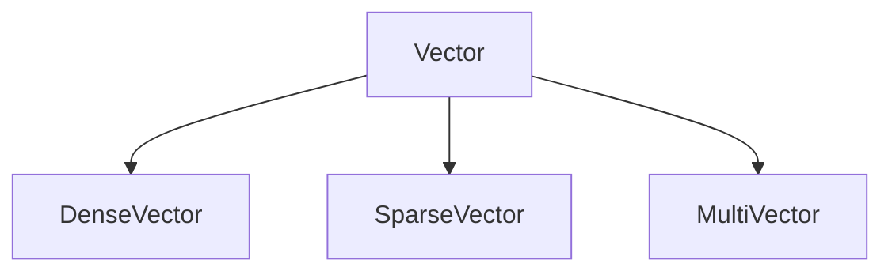
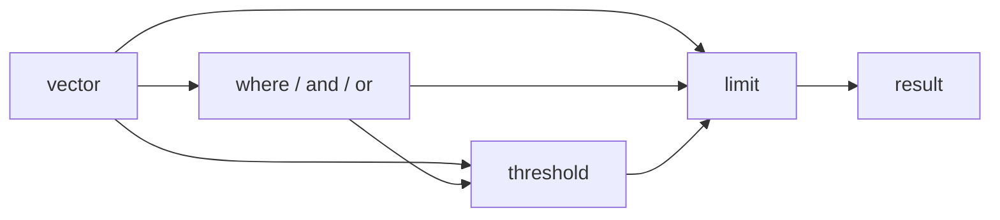

> **Upcoming release.** The Vector Mapping API (`jnosql-mapping-vector`, `VectorTemplate`, `DenseVector`, `SparseVector`, `MultiVector`) is documented on the development (`main`) branch of [Eclipse JNoSQL](https://github.com/eclipse-jnosql/jnosql), currently `2.0.0-SNAPSHOT`. At the time of writing, no `jnosql-mapping-vector` artifact has been published to Maven Central, and the Vector drivers in [jnosql-databases](https://github.com/eclipse-jnosql/jnosql-databases) are documented as `1.1.21-SNAPSHOT`. Everything on this page requires that upcoming release.

## 1. Introduction to Vector NoSQL Databases

A Vector database stores and searches numerical representations of information. A **vector** is an ordered collection of numerical values that represent features or characteristics of some data. Vectors are frequently produced by machine learning models, but their usefulness is not limited to generative AI.

Traditional retrieval is field-based: you ask for the article whose author or title matches a condition. Similarity-oriented retrieval is different: you ask for the articles whose numerical representations are close to a query vector, according to a configured similarity or distance metric.

### Why Choose a Vector Database?

* Similarity search.
* Semantic retrieval.
* Recommendation systems.
* Image and multimedia similarity.
* Feature-based matching.
* Hybrid searches that combine vector similarity with metadata conditions.
* Integration with machine learning applications.

### Representative Use Cases

* Semantic document search.
* Product recommendations.
* Fraud pattern similarity.
* Customer behavior analysis.
* Knowledge retrieval.
* Retrieval-Augmented Generation (RAG).
* Image and audio similarity.
* Duplicate or near-duplicate detection.

### Trade-offs

* Storage cost of high-dimensional vectors.
* Approximate nearest-neighbor search.
* Index building and maintenance.
* Recall versus latency.
* Similarity metric selection.
* Embedding model compatibility.
* Dimension restrictions.
* Filtering performance.
* Provider-specific indexing options.
* Data updates and reindexing.

Vector databases do not always return exact nearest neighbors. Search accuracy, performance, and supported features depend on the database and its configuration.

## 2. Understanding Vector Representations

A vector consists of numerical dimensions. For example, this is a three-dimensional vector:

```text
[0.12, 0.45, 0.78]
```

Each dimension is a numerical feature. **Similarity** (or its opposite, **distance**) is computed between two vectors with the same dimensions.

### Embeddings

Embeddings are vectors generated to represent information such as text, images, or audio. Two articles that discuss similar concepts may produce nearby embeddings, but whether they are actually close depends on the embedding model and the selected metric.

### Similarity Metrics

* **Cosine similarity** compares the direction of two vectors.
* **Euclidean distance** measures the straight-line distance between two vectors.
* **Dot product** takes both direction and magnitude into account.

These metrics measure different things; their scores do not have interchangeable meanings or identical ranges. The database provider usually determines which metrics and indexing strategies are supported.

### Embedding Generation

**Eclipse JNoSQL does not generate embeddings.** Applications can obtain vectors from language models, image or audio encoders, recommendation models, feature extraction systems, or other numerical pipelines. JNoSQL focuses on mapping, persisting, and querying vectors through Java APIs.

## 3. Minimum Requirements

Vector Mapping uses the common platform requirements described in [Minimum Requirements](/docs/minimum.html). Database integrations can add runtime dependencies, vector-type restrictions, and configuration requirements.

## 4. Choosing a Vector Database

JNoSQL connects to Vector database technologies through provider integrations. When choosing one, consider:

* Supported vector types.
* Maximum dimensions.
* Similarity metrics.
* Exact versus approximate search.
* Index configuration.
* Filtering capabilities.
* Data consistency and update semantics.
* Availability and scalability.
* Operational costs.
* Authentication and deployment options.

The [jnosql-databases](https://github.com/eclipse-jnosql/jnosql-databases) repository is the primary reference. At the time of writing, it contains Vector drivers for **Qdrant** (`jnosql-qdrant`), **Milvus** (`jnosql-milvus`), and **Weaviate** (`jnosql-weaviate`). API-level support is not provider-level support: not every database supports all three JNoSQL vector representations, so check the driver documentation.

## 5. Adding the Vector Mapping Dependency

```xml
<dependency>
    <groupId>org.eclipse.jnosql.mapping</groupId>
    <artifactId>jnosql-mapping-vector</artifactId>
    <version>${jnosql.version}</version>
</dependency>
```

Set `jnosql.version` in your build to a release that contains the Vector Mapping module. The development branch is `2.0.0-SNAPSHOT`. The released `1.1.20` does not provide it. This website does not define a JNoSQL core version variable (only `jnosql_databases_version`, currently `{{ site.jnosql_databases_version }}`), so the version is not hardcoded here.

You also need a database integration, which is a separate dependency. For example, for Qdrant, as documented by the driver (the version is a snapshot until a release is published):

```xml
<dependency>
    <groupId>org.eclipse.jnosql.databases</groupId>
    <artifactId>jnosql-qdrant</artifactId>
    <version>${jnosql.databases.version}</version>
</dependency>
```

## 6. Configuring a Vector Database

JNoSQL reads settings through [MicroProfile Config](https://microprofile.io/specifications/microprofile-config/):

```properties
jnosql.vector.database=<DATABASE>
jnosql.vector.provider=<CLASS-DRIVER>
```

`jnosql.vector.database` is the database name, and `jnosql.vector.provider` is the fully qualified provider configuration class. A concrete Qdrant example from the driver documentation:

```properties
jnosql.vector.database=library
jnosql.vector.provider=org.eclipse.jnosql.databases.qdrant.communication.QdrantConfiguration
jnosql.qdrant.host=localhost
jnosql.qdrant.port=6334
jnosql.qdrant.collection.distance=COSINE
jnosql.qdrant.collection.vector.size=3
```

In this driver, the distance metric belongs to the collection configuration; it is not chosen per `search(...)` query. Other providers define their own properties.

## 7. Mapping Java Entities to Vector Data

A regular Jakarta NoSQL entity can declare **one** persisted field whose type implements `Vector`. The field must be annotated with `@Column`.

```java
import jakarta.nosql.Column;
import jakarta.nosql.Entity;
import jakarta.nosql.Id;
import org.eclipse.jnosql.mapping.vector.Vector;

@Entity
public class Article {

    @Id
    private String id;

    @Column
    private String content;

    @Column
    private String author;

    @Column
    private int year;

    @Column
    private Vector embedding;

    Article() {
    }

    public Article(String id, String content, String author, int year, Vector embedding) {
        this.id = id;
        this.content = content;
        this.author = author;
        this.year = year;
        this.embedding = embedding;
    }

    public String getId() { return id; }

    public String getContent() { return content; }

    public String getAuthor() { return author; }

    public int getYear() { return year; }

    public Vector getEmbedding() { return embedding; }
}
```

For a vector database, the entity is interpreted conceptually as:

```text
Article
├── id         → identifier
├── embedding  → vector
└── payload
    ├── content
    ├── author
    └── year
```

* **Identifier:** the `@Id` field identifies the entity.
* **Vector:** the attribute whose type implements `Vector` holds the numerical data used for similarity search.
* **Payload:** the other persisted attributes are metadata associated with the vector.

The vector field does not need a particular name such as `embedding`; it is identified through the `Vector` type hierarchy. The mapping contract describes one vector attribute per entity. How the identifier, vector, and payload are serialized is up to each provider.

## 8. DenseVector, SparseVector, and MultiVector

`Vector` is the abstraction, with three implementations:



| Representation | Characteristics | Typical Use |
|---|---|---|
| `DenseVector` | Value for each dimension | Semantic embeddings |
| `SparseVector` | Explicit indexed values | Sparse or lexical embeddings |
| `MultiVector` | Multiple dense vectors | Multi-part representations |

### 8.1 DenseVector

A `DenseVector` stores one value for each dimension.

```java
DenseVector vector = DenseVector.of(
        0.12F,
        0.45F,
        0.78F
);
```

It is commonly used for text semantics, image similarity, recommendations, audio embeddings, and other machine learning features. Memory grows linearly with the number of dimensions, so dimension count directly affects storage and search cost. A dense vector needs at least one dimension, and every component must be finite.

### 8.2 SparseVector

A `SparseVector` stores only the non-zero values together with their positions.

```text
Original:
[0, 0, 7, 0, 0, 0, 0, 0, 3, 0]

Dimensions: 10
Indices:    [2, 8]
Values:     [7, 3]
```

```java
SparseVector vector = SparseVector.of(
        10,
        SparseVector.element(2, 7.0F),
        SparseVector.element(8, 3.0F)
);
```

This is useful when a vector has many dimensions but few explicit values, as with lexical representations or sparse embedding models. The implementation validates that the dimensions are greater than zero, indices are within range, unique and strictly increasing, and that values are finite and non-zero. Not every provider supports sparse vector indexing.

### 8.3 MultiVector

A `MultiVector` represents one logical value through multiple dense vectors.

```text
[
    [0.2, 0.8, 0.1],
    [0.7, 0.1, 0.4],
    [0.3, 0.6, 0.9]
]
```

```java
MultiVector vector = MultiVector.of(
        DenseVector.of(0.2F, 0.8F, 0.1F),
        DenseVector.of(0.7F, 0.1F, 0.4F),
        DenseVector.of(0.3F, 0.6F, 0.9F)
);
```

Use cases include multiple text segments, regions of an image, document sections, or multiple representations of one logical entity. The vectors must not be empty and must all have the same number of dimensions. Having multiple vectors does not imply a particular ranking or aggregation algorithm; those semantics depend on the provider.

## 9. VectorTemplate and the Jakarta NoSQL Template API

`VectorTemplate` (`org.eclipse.jnosql.mapping.vector.VectorTemplate`) builds on the Jakarta NoSQL `Template` model, so the regular mapping and persistence operations still apply. It adds `search(Class)` for vector search.

```java
import jakarta.inject.Inject;
import org.eclipse.jnosql.mapping.vector.VectorTemplate;

@Inject
VectorTemplate template;

Article article = new Article(
        "article-123",
        "Jakarta NoSQL and vector databases",
        "Example Author",
        2026,
        DenseVector.of(0.12F, 0.45F, 0.78F)
);

template.insert(article);

Optional<Article> result =
        template.find(Article.class, "article-123");
```

`insert` persists the entity, mapping the `Vector` attribute and the payload attributes; `find` retrieves it by identifier. `VectorTemplate` does not abandon the common persistence model; it extends it with an operation that is meaningful for vector databases.

## 10. Fluent Vector Search API

Vector databases often expose proprietary search APIs and query objects. JNoSQL offers a familiar fluent API that works on mapped entities, with less driver-specific boilerplate, composable metadata conditions, result limiting, and threshold filtering.

### 10.1 Basic Vector Search

```java
import jakarta.data.Limit;

Vector queryVector = DenseVector.of(
        0.10F,
        0.42F,
        0.80F
);

List<Article> articles =
        template.search(Article.class)
                .vector(queryVector)
                .limit(Limit.of(10))
                .result();
```

1. `search(Article.class)` starts a vector search for the mapped entity.
2. `vector(queryVector)` supplies the reference vector.
3. `limit(Limit.of(10))` restricts the number of results.
4. `result()` executes the query and returns mapped entities.

The query vector must be compatible with the stored representation and the provider's requirements, such as the number of dimensions. The API does not specify the distance calculation or whether the search is exact; that is up to the provider and its configuration.

### 10.2 Combining Similarity and Metadata Filters

```java
List<Article> articles =
        template.search(Article.class)
                .vector(queryVector)
                .where("author").eq("Example Author")
                .and("year").gte(2024)
                .limit(Limit.of(10))
                .result();
```

Vector search combines with ordinary conditions, so applications can express similarity together with domain constraints such as author, year, category, document type, or a tenant identifier. The condition steps offered are `eq`, `ne`, `gt`, `gte`, `lt`, and `lte`, joined with `and` or `or`. Actual filtering support depends on the provider, and filtering is not necessarily pushed into the vector index or evaluated in the same order everywhere.

### 10.3 Similarity and Distance Thresholds

```java
List<Article> articles =
        template.search(Article.class)
                .vector(queryVector)
                .threshold(0.85F)
                .limit(Limit.of(10))
                .result();
```

A threshold constrains the results using the similarity or distance metric configured in the underlying database. `0.85F` does not universally mean "85% similar": metrics have different ranges and meanings, and a threshold for cosine similarity cannot be read the same way as one for Euclidean distance. The semantics are determined by the provider and the configured metric.

### 10.4 Combining Filters and Thresholds

```java
List<Article> articles =
        template.search(Article.class)
                .vector(queryVector)
                .where("author").eq("Example Author")
                .and("year").gte(2024)
                .threshold(0.85F)
                .limit(Limit.of(10))
                .result();
```

The order is fixed by the API: `vector(...)`, then optional conditions, then an optional `threshold(...)`, then `limit(...)`, and finally `result()`. Conditions and `threshold` are optional, but `limit` is required before `result()`.



## 11. How Vector Search Extends the Fluent API

Vector search reuses familiar Jakarta NoSQL query concepts and adds two vector-specific ones:

* **Query vector:** the numerical reference used to evaluate similarity.
* **Threshold:** an optional condition that restricts results according to the configured metric.

Conditions such as `where` and `and`, and result limiting, stay part of the familiar experience. Developers keep a common Java style without treating vector search as an ordinary scalar-field query. Jakarta NoSQL does not standardize these vector operations; `VectorTemplate` and the search API are Eclipse JNoSQL extensions.

## 12. Vector Search Versus Traditional Queries

A traditional query filters entities using known field values:

```java
template.select(Article.class)
        .where("year").gte(2024)
        .result();
```

A vector search retrieves entities according to similarity or distance to a vector, optionally combined with field conditions:

```java
template.search(Article.class)
        .vector(queryVector)
        .limit(Limit.of(10))
        .result();
```

Traditional queries express exact or predicate-based conditions; vector search provides similarity-oriented retrieval. They solve different problems and complement each other.

## 13. Using Jakarta Data Repositories

Jakarta Data provides repository abstractions for persistence. The Vector Mapping module supports them: its tests use a `BasicRepository` for the `Article` entity.

```java
import jakarta.data.repository.BasicRepository;
import jakarta.data.repository.Repository;

@Repository
public interface ArticleRepository
        extends BasicRepository<Article, String> {
}
```

* **Jakarta Data repository:** declarative entity persistence and the supported repository operations (such as `save`, `findById`, and `deleteById`).
* **`VectorTemplate`:** use it when you need vector-specific search.

Repository method-name derivation does not express similarity queries, and there is no such thing as a `findSimilarByEmbedding` method. Use `VectorTemplate.search(...)` for similarity search.

## 14. Using Multiple Vector Database Providers

The `@Database` qualifier with `DatabaseType.VECTOR` selects the Vector persistence context:

```java
import org.eclipse.jnosql.mapping.Database;
import org.eclipse.jnosql.mapping.DatabaseType;

@Inject
@Database(DatabaseType.VECTOR)
ArticleRepository repository;
```

`DatabaseType.VECTOR` exists in the framework. Applications that use several named providers can use the same `provider` attribute shown for the other models (for example `@Database(value = DatabaseType.VECTOR, provider = "...")`), such as separating product embeddings from document embeddings. This combination has not been verified for Vector end to end, so check your provider's documentation before relying on it.

## 15. Vector Database Capabilities and Trade-offs

JNoSQL provides the Java abstraction; the selected database determines how vector search is executed.

* **Indexing:** databases may use exact or approximate nearest-neighbor strategies. Algorithms such as HNSW and IVF are common, but not every provider implements them.
* **Similarity metrics:** supported metrics differ. The Qdrant driver, for example, lists `COSINE`, `EUCLID`, `DOT`, and `MANHATTAN`.
* **Dimensionality:** providers can restrict vector dimensions.
* **Sparse and multi-vector support:** not every database supports all three representations.
* **Filtering:** payload filtering is implemented differently by each provider.
* **Performance:** latency and recall depend on index configuration, dataset size, dimension count, and workload.
* **Data updates:** changes can require index maintenance or rebuilding.

### Portability

Switching providers can require changes to dependencies, configuration, index definitions, vector dimensions and formats, similarity metrics, serialization, data migration, and query behavior. JNoSQL reduces coupling at the Java API level, but it does not remove database differences.

## 16. Integrating Vector Persistence with AI Applications

In applications such as semantic search and RAG, the typical flow is:

1. The application receives a document.
2. An external embedding model generates its numerical representation.
3. JNoSQL persists the document, vector, and payload.
4. A user submits a search query.
5. The application generates a query embedding with a compatible model.
6. `VectorTemplate` searches for similar entities.
7. The application processes the results.

JNoSQL is responsible for persistence and retrieval, not model inference or embedding generation. The embedding model used for stored data and for queries must be the same or compatible.

## 17. Jakarta EE Data Ecosystem

* **Jakarta NoSQL:** the mapping annotations (`@Entity`, `@Id`, `@Column`) and the `Template` model.
* **Jakarta Data:** repositories, as in Section 13.
* **[Jakarta Query](https://github.com/jakartaee/query):** its integration into Eclipse JNoSQL is under development.

`VectorTemplate`, `Vector`, and the vector search API are Eclipse JNoSQL-specific extensions. Neither Jakarta NoSQL nor Jakarta Query currently defines them. See the [Introduction](/docs/introduction.html) for the overall architecture.

## 18. Explore Vector Database Integrations

This guide introduces the JNoSQL Vector programming model. Provider-specific documentation covers connection configuration, index creation, similarity metrics, supported vector representations, filtering, authentication, and performance settings.

* [jnosql-databases](https://github.com/eclipse-jnosql/jnosql-databases)
* [Eclipse JNoSQL](https://github.com/eclipse-jnosql/jnosql)
* [Jakarta NoSQL](https://github.com/jakartaee/nosql)
* [Jakarta Data](https://github.com/jakartaee/data)
* [Supported Databases](/docs/supported_dbs.html)
* Example applications: [demos-se](https://github.com/JNOSQL/demos-se) and [demos-ee](https://github.com/JNOSQL/demos-ee)
